# 🤖 Öğretmen Atama Robotu

**Tur bazlı, gerekçeli ve şeffaf öğretmen atama sistemi.**
Öğretmen tercihlerini ve okul ihtiyaçlarını toplar, **2026-2027 dönemi MEB atama kurallarına göre** yapılandırılmış robotla adil ve tekrarlanabilir biçimde yerleştirir; her öğretmene ve her okula **neden bu sonucun çıktığını** tek tek gösterir.

> 📌 Bu depo yalnızca **tanıtım** amaçlıdır. Yazılımın **kaynak kodu paylaşılmamaktadır**; ticari bir üründür.
> Ekran görüntüleri **örnek (anonim) verilerle** hazırlanmıştır; gerçek kişi ve kurum bilgisi içermez.

---

## ✨ Öne çıkanlar

### 🔁 Tur bazlı atama modeli
- Atama tek seferde bitmez: **1. tur, 2. tur, 3. tur…** sınırsız sayıda tur yürütülür.
- Her tur **kendi içinde yalıtılmıştır** — 1. tur 2. turu, 1. ve 2. tur 3. turu etkilemez.
- Bir turda **atanan öğretmen** (göreve başlasın ya da başlamasın) sonraki turlara katılamaz.
- **Atanamayan öğretmen** sonraki turda yeniden tercih yapar; eski turun tercihleri geçersiz sayılır.
- Sonuçlar yayımlandığında turun ilan ve başvuruları **arşivlenir**; yalnızca gözlem ve analiz içindir.
- Öğretmen ve okul profil bilgileri sabit kalır; yalnızca atama işlemleri tura göre değişir.

### 🎯 Kademeli (öncelikli) atama robotu
- **Alan Eşleştirme tablosuna** göre (bölüm ↔ atamaya esas alan) üç öncelik derecesi: **1 · Asıl alan**, **2 · Eş değer**, **3 · Son çare**.
- Aynı kademede sıralama: **AGS puanı → diploma notu (4'lük)**; tüm eşitlik kuralları sabit ve tekrarlanabilir.
- Geçen yıl **MEB kurumunda görev yapmış** adaylara 2. ve 3. öncelikte öncelik.
- **İngilizce** ilanlarında bölüm eşleşmesi + **CEFR seviyesine (C2 → A1)** göre değerlendirme.
- **"Her yerde çalışabilirim"** tercihi için son kademe.
- Alan Eşleştirme tablosu yönetici tarafından ekrandan **yönetilir** (ekle / düzenle / sil).

### 🔎 Her sonuç için gerekçe
- Öğretmen, **her tercihinin** neden tuttuğunu ya da tutmadığını görür: kontenjan doldu, yerleşenlerin puanı, branş önceliği, üst tercihe yerleşti…
- Yönetici, öğretmen listesindeki 🟢 / 🔴 rozetine tıklayarak **tur tur tercih formunu ve gerekçeleri** açar.
- Öğretmen profilinde **hangi alanlara hangi öncelikle atanabileceği** açıkça yazar.

### 🔐 KVKK uyumlu görünürlük
- Okul, başvuran adayların ad ve telefonunu **maskeli** görür; yalnızca **kendisine atanan** adayın bilgileri açılır.
- Yönetici ve kritik işlemler denetim kaydına alınır.

### 📱 Her cihazda çalışır
- Yönetici, öğretmen ve okul panelleri masaüstü ve **mobil** ekranlara uyumludur.

---

## 🖼️ Ekran görüntüleri

### Yönetici paneli

**Atama Turları** — kayıt, başvuru ve ilan girişlerini tek yerden aç/kapat; turları yönet.
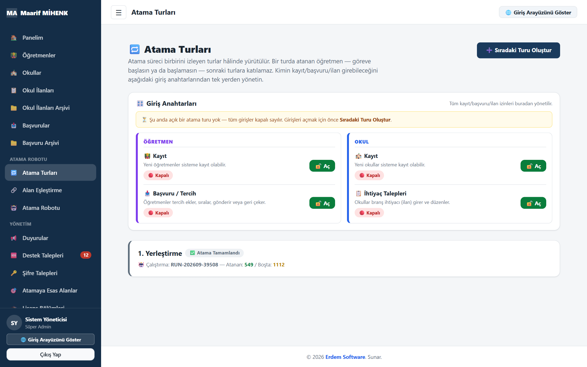

**Alan Eşleştirme** — bölüm ↔ atamaya esas alan eşleşmeleri ve öncelik dereceleri.
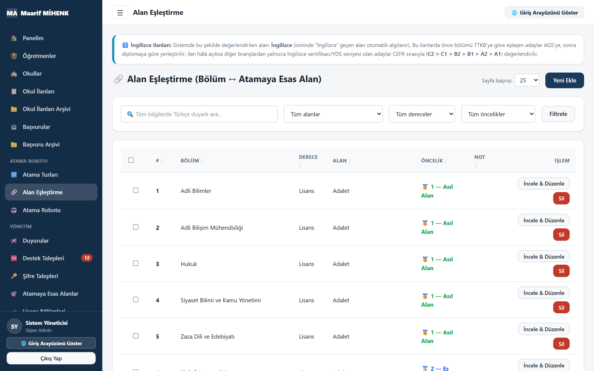

**Atama Robotu** — çalıştırma kayıtları, yayınlama ve geçersiz kılma.
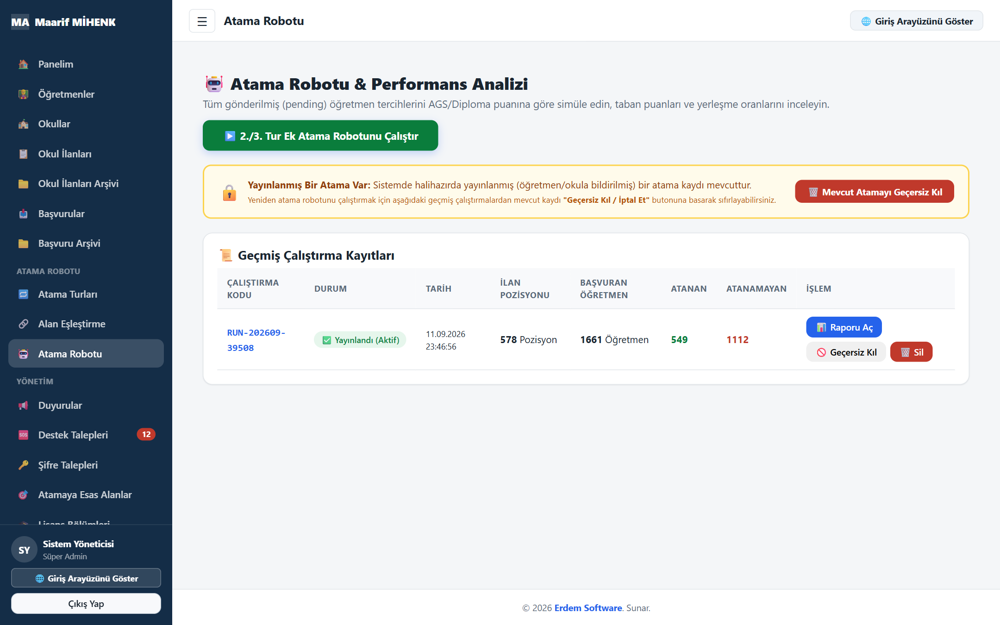

**Atama raporu** — bölüm bazlı yerleşme oranı, taban ve tavan puanlar.
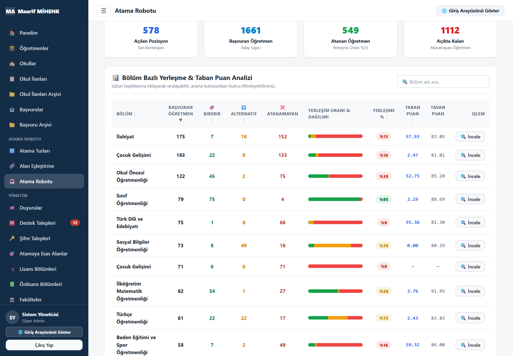

**Öğretmen yönetimi** — 🟢 atandı / 🔴 atanamadı rozetleri tüm turları kapsar.
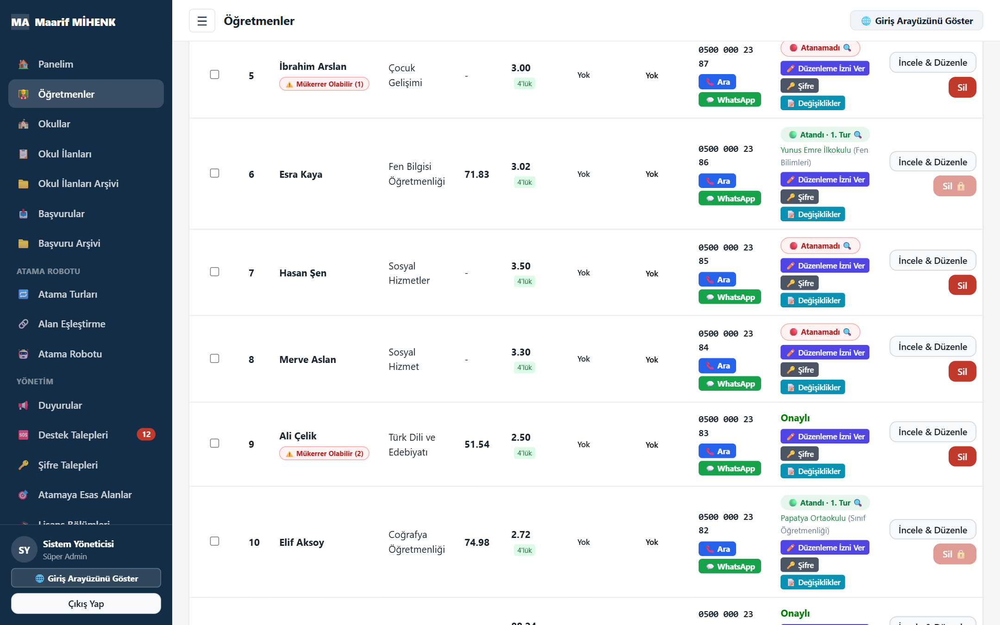

**Tur bazlı tercih geçmişi** — her tercih için sonuç ve gerekçe.
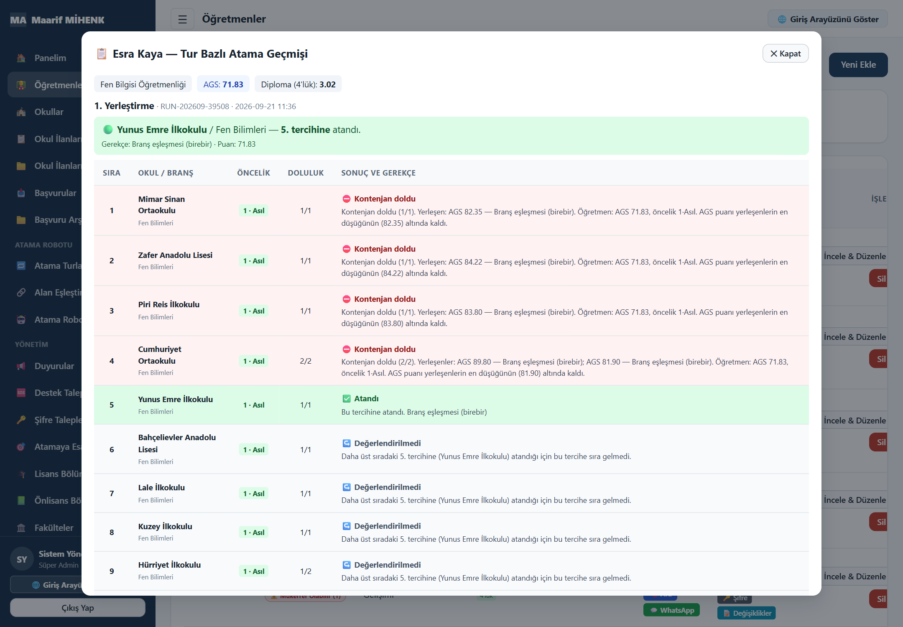

**Raporlar** — tur seçerek okul, branş ve başvuru istatistikleri.
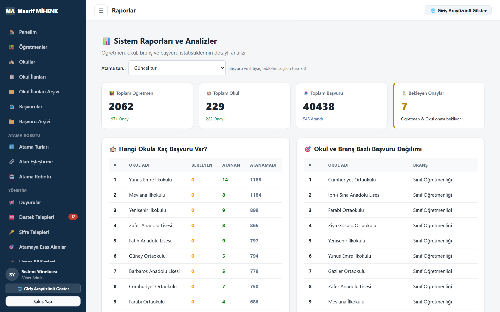

**Panel**
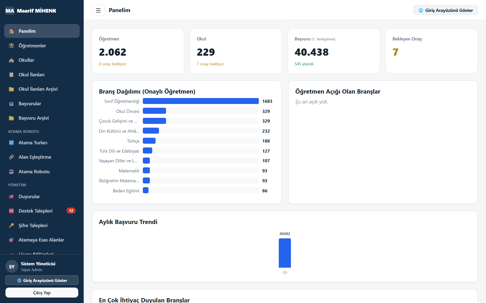

### Öğretmen paneli

**Sonuçlarım** — tur tur sonuç, atanılan okulun iletişim bilgileri ve her tercihin gerekçesi.
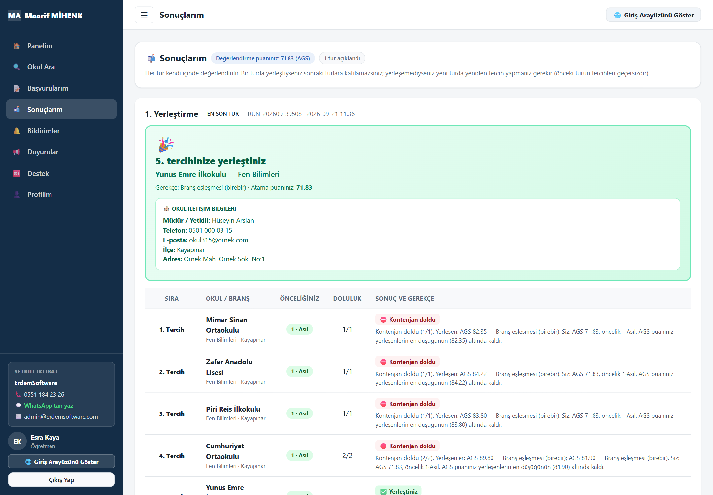

**Atanabileceğiniz alanlar** — Alan Eşleştirme'ye göre öncelikler; Sınıf Öğretmenliği ve İngilizce için özel açıklamalar.

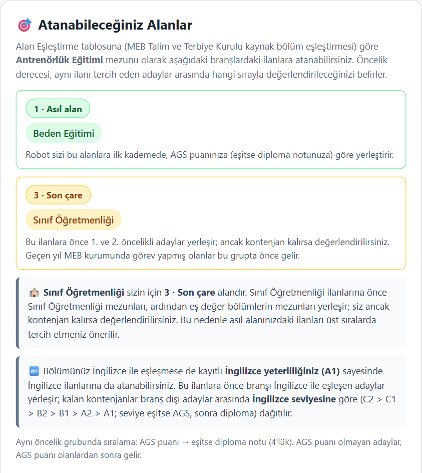

**Başvurularım** — gönderilmiş, kilitli tercih listesi; geçmiş turlar ayrı bölümde.
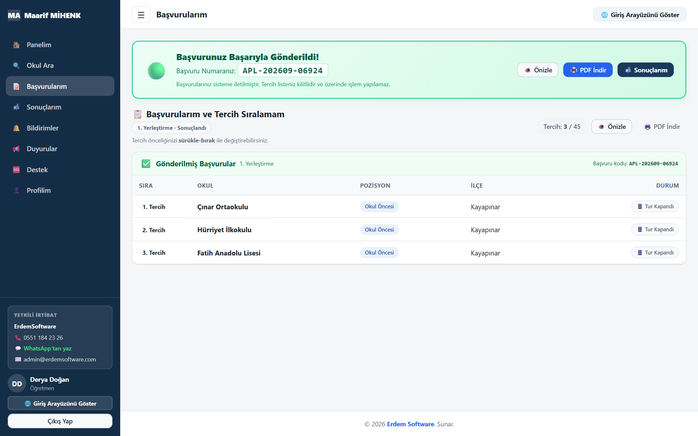

**Mobil görünüm**

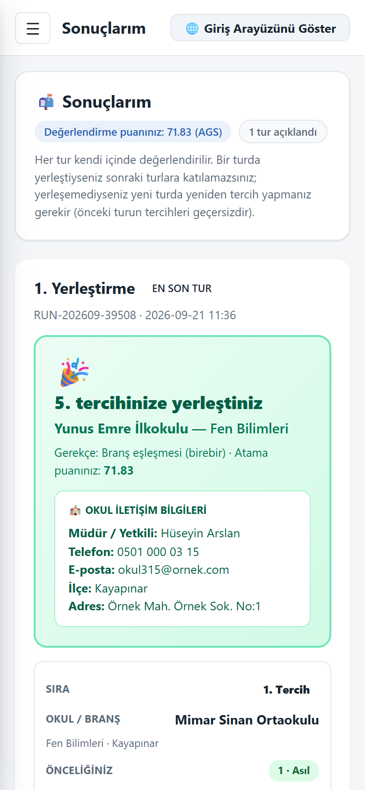

### Okul paneli

**Panel** — güncel turun ihtiyaç ve başvuru özeti; atanmayan adayların bilgileri maskeli.
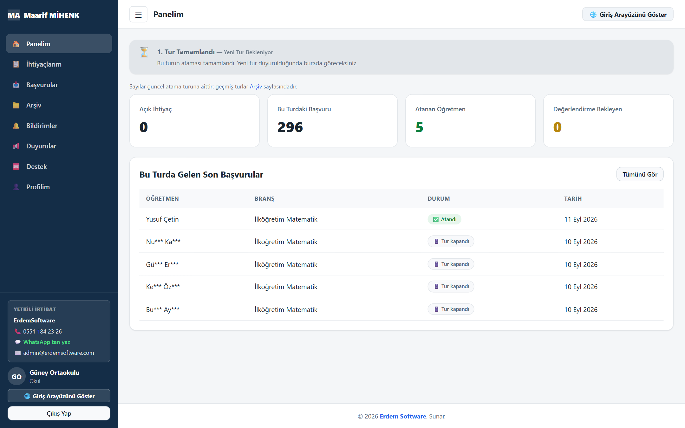

---

## ⚙️ Süreç nasıl işler?

1. **Kayıt ve giriş:** Okullar kayıt olup branş ihtiyaçlarını girer; öğretmenler kayıt olup tercihlerini sıralar. Yönetici tek ekrandan hangi girişin açık olacağına karar verir.
2. **Kapanış:** Yönetici başvuru ve ilan girişlerini kapatır.
3. **Robot:** Atama robotu tercihleri kademeli kurallarla değerlendirir ve sonuç raporunu üretir; yönetici raporu inceler.
4. **Yayın:** Sonuçlar yayımlanır; öğretmenlere ve okullara **gerekçeleriyle** iletilir.
5. **Arşiv:** Turun ilan ve başvuruları arşivlenir. Atananlar sonraki turlara katılmaz.
6. **Yeni tur:** Atanamayanlar ve boş kalan kontenjanlar için yeni tur açılır; süreç aynı kurallarla tekrarlanır.

---

## 📞 İletişim

Bilgi ve demo için ulaşabilirsiniz:

- 💬 **WhatsApp:** [0551 184 23 26](https://wa.me/905511842326)
- ✈️ **Telegram:** [@erdem21](https://t.me/erdem21)

---

© 2026 Erdem Software. Tüm hakları saklıdır. Bu depodaki metin ve görseller izinsiz kopyalanamaz, dağıtılamaz. Yazılımın kaynak kodu bu depoda yer almaz ve paylaşılmaz.
